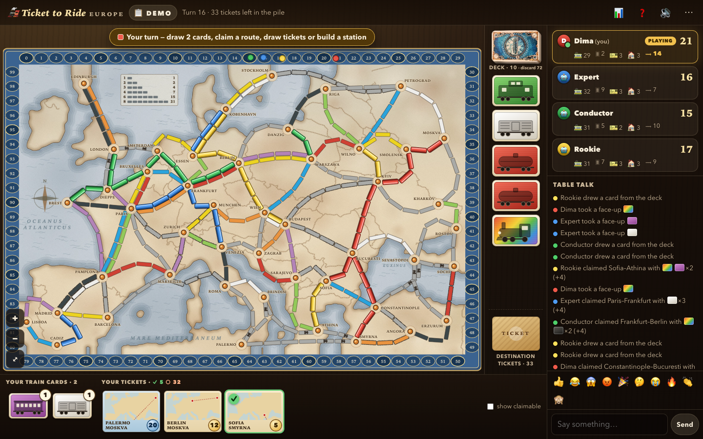

# Ticket to Ride: Europe — online

Play Ticket to Ride: Europe with friends in the browser. One person runs a small Python server, everyone else
just opens a link. It has the full official rules on a board that looks like the real one, and bots that can
fill empty seats.



## Features

- **Complete official rules**: tunnels, ferries, stations, double routes, long and short destination tickets,
  the final round, and the European Express bonus for the longest route.
- **A board that looks like the printed one**: cities and route curves are traced from a photo of the real board.
- **2–5 players**: any mix of humans and bots, with three bot levels from beginner to strong.
- **Multiplayer in the browser**: invite friends over your Wi-Fi or with a public link. Players can reconnect,
  move their seat to another device, or hand it to a bot if they drop out.
- **Table extras**: chat and emoji reactions, sounds, hints, an optional turn timer, and keyboard shortcuts.
- **Fair play**: the server holds the game state and checks every move. Clients only send what a player wants
  to do and never see other players' hidden cards.

## Requirements

- [uv](https://docs.astral.sh/uv/getting-started/installation/). It installs Python 3.12 and all
  dependencies for you.
- Optional: [cloudflared](https://developers.cloudflare.com/cloudflare-one/connections/connect-networks/downloads/),
  to invite friends from outside your network (`brew install cloudflared` on macOS).

## Quick start

```bash
git clone https://github.com/dmytro-mz/ttr.git
cd ttr
uv run ttr serve
```

Open <http://localhost:8000>, click **Create a table**, add bots or send the invite link to friends, and
click **Start game**.

### Inviting friends

| Command | Who can join |
| --- | --- |
| `uv run ttr serve` | People on the same Wi-Fi/LAN, through the network link printed at startup |
| `uv run ttr serve --tunnel` | Anyone, through a temporary public `trycloudflare.com` link |
| `uv run ttr serve --public-url https://…` | Anyone, if you host the server behind your own domain or reverse proxy |

Run `uv run ttr serve --help` for all options (host, port, and so on).

## How to play

- **Draw cards**: click the face-up cards or the deck on the right.
- **Claim a route**: click it on the map and choose how to pay. Routes you can afford glow.
- **Build a station**: click a city.
- **Draw destination tickets**: click the ticket pile.

Hover a ticket to see its cities on the map, and click it to keep them highlighted. Click a player to
highlight their trains.

**Keyboard:** `D` draws from the deck, `1`–`5` take a face-up card, `T` draws tickets, `H` asks for a hint,
`+`/`−`/`0` zoom, and `Esc` closes dialogs.

**Table options (host only):** turn timer (when it runs out, the autopilot plays your turn), bot speed, hints,
and the house rule "both double tracks with 2–3 players".

If a friend drops out, the host can let a bot play for them. **⋯ → Continue on another device** gives you a
personal link to move your seat to another device, for example your phone.

## Bots

| Bot | Strength | Plays like |
| --- | --- | --- |
| Rookie | ★ | random tickets, random routes |
| Conductor | ★★★ | plans each ticket separately, rarely takes new tickets, no stations |
| Expert | ★★★★★ | plans tickets together, draws more tickets, uses stations, optimises the last turn |

Compare bots head to head (seats rotate and games run in parallel):

```bash
uv run ttr eval -a expert,conductor -n 400
```

## Development

```bash
uv sync                                                    # install runtime + dev dependencies
uv run pytest                                              # rules, map, bots, room protocol, hidden-info checks
uv run ruff check --fix src tests scripts && uv run ruff format src tests scripts
```

The browser checks drive Google Chrome through Playwright. They expect Chrome at the default macOS path, set by
`CHROME` in `scripts/shot.py` and `scripts/ui_check.py`:

```bash
uv run python scripts/demo.py --stage play --out shots/game.png   # screenshot a seeded table (play|tickets|over|lobby)
uv run python scripts/ui_check.py                                 # click through a whole game; fails on any JS error
```

### Project layout

```
src/ttr/
  game/      pure rules engine (no I/O): map data, rules helpers, actions, the Game state machine
  bots/      Bot interface, route planner, and the Rookie / Conductor / Expert bots
  web/       room logic, FastAPI + WebSocket server, and the vanilla JS client in static/ (no build step)
  runner.py  play a bot-only game
  cli.py     the `ttr` command (serve, eval)
scripts/     map tracing from the board photo, plus screenshot and browser checks
tests/       pytest suite
```

Dependencies only point downwards: `game` imports nothing from the project, `bots` imports `game`, and `web`
imports both. More detailed conventions and invariants (the server is authoritative, no hidden information
leaks, card conservation) are in [`.cursor/rules/`](.cursor/rules/).

### Map data

The map geometry (city positions, route curves, coastline) was traced from a photo of the printed board with
`scripts/find_cities.py` and `scripts/trace_land.py`. The results are committed
(`src/ttr/game/europe.py`, `src/ttr/game/europe_paths.py`, `src/ttr/web/static/land.json`), so you only need
these scripts to re-trace the map. The board photo is not included in this repository. To re-trace, put your
own photo at `scripts/assets/board_photo.jpg`. Country borders come from
[Natural Earth](https://www.naturalearthdata.com/) (public domain) and are warped onto the board by
`scripts/build_land.py`.

## Contributing

Issues and pull requests are welcome. Before you open a PR:

1. Put any rules change in `src/ttr/game/` and add a test in `tests/test_engine.py` or `tests/test_rules.py`.
2. For UI changes, render a screenshot with `scripts/demo.py`, check it, and run `scripts/ui_check.py`.
3. Make sure `uv run pytest` passes and ruff reports nothing.

## License and credits

The code is released under the [MIT License](LICENSE).

- Sound effects are trimmed from free clips on [Pixabay](https://pixabay.com/) (Pixabay Content License).
- Country borders: [Natural Earth](https://www.naturalearthdata.com/), public domain.

This is an unofficial fan project for private games with friends. It is not affiliated with or endorsed by
Days of Wonder or Asmodee. *Ticket to Ride* is a trademark of Days of Wonder, Inc. If you enjoy the game,
please buy the real board game.
